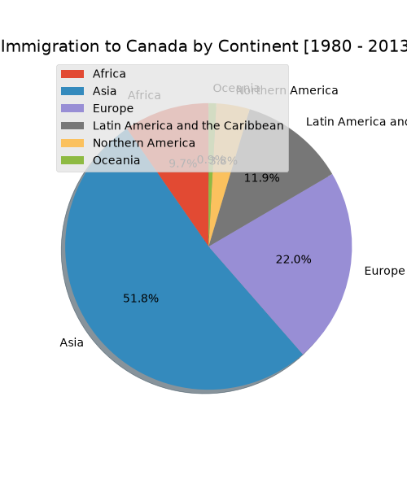
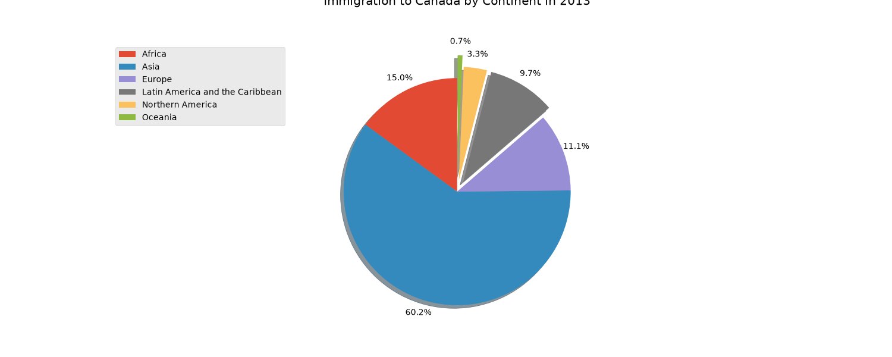

# data-science-project
# Canada Immigration Data Analysis (1980 - 2013)

## 1. Problem / Research Question
How is the distribution of immigration to Canada across different continents? Specifically, what is the historical trend from 1980 to 2013, and how does the recent single-year data (2013) compare to the overall historical average?

## 2. Dataset Source & Usage Permissions
- **Source:** The dataset is sourced from the IBM Developer Skills Network (publicly available via cloud object storage).
- **Permissions:** This is an open, public dataset provided for educational and analytical purposes. No sensitive personal data is included.

## 3. Methods & Tools
- **Tools:** Python 3, Jupyter Notebook.
- **Libraries:** `pandas` (for data loading and manipulation), `matplotlib` (for data visualization).
- **Methods:** Data extraction, grouping by continent, and generating pie charts to compare relative proportions. The 2013 chart uses the `explode` parameter to highlight smaller segments.

## 4. Key Findings & Limitation
- **Key Findings:** Asia is the dominant source of immigration to Canada. From 1980 to 2013 overall, Asia accounted for **51.8%** of total immigrants. In the year 2013 alone, this proportion increased significantly to **60.2%**, showing a growing trend from Asian countries. Meanwhile, Europe's share dropped from 22.0% (historical) to 11.1% (2013).
- **Limitation:** The pie charts only show relative percentages, not absolute numbers. We cannot determine if 2013 had more total immigrants than previous years based purely on these charts. Additionally, grouping by "Continent" hides specific country-level trends.

## 5. Instructions for Running the Analysis
To reproduce this analysis locally, follow these steps:

1. Clone this repository to your local machine:
   ```bash
   git clone https://github.com/taryntao827/data-science-project.git
   cd data-science-project
2. Install the required Python packages:
   ```bash
   pip install -r requirements.txt
3. Launch Jupyter Notebook:
   ```bash
   jupyter notebook
4. Open the analysis notebook (e.g., analysis.ipynb) and run all cells.

## 6. Visualizations

 


